# HabitMiner Extended 📱🧠

**A context-aware digital habit, sleep and routine tracker for Android**

[](LICENSE)
[](https://kotlinlang.org/)
[](https://developer.android.com/)
[](#-whats-new-in-extended)

HabitMiner Extended is the next version of [HabitMiner](README_OLD.md). It installs as its own app (**HM Extended**, `com.habitminer.extended`) next to the original, can bring the original's history across, and adds a redesigned interface, better sleep and nap tracking, goals, and a long list of accuracy fixes found by using it every day.

Everything stays on the phone. There is no account and no server; data leaves the device only when you export it.

---

## 📸 Screenshots

<p align="center">
  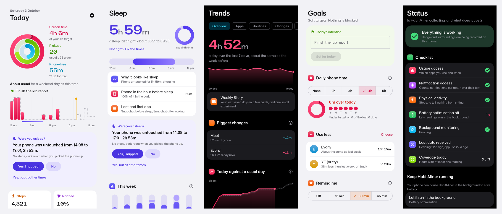
</p>

<table>
  <tr>
    <td align="center" valign="top" width="33%">
      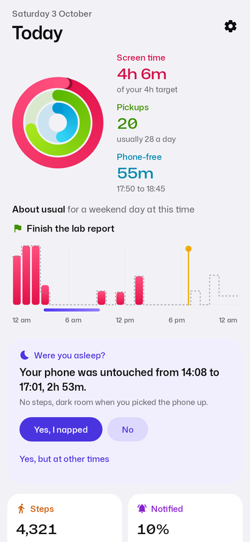<br>
      <b>Today</b><br>
      <sub>Rings for screen time, pickups and phone-free time, today against a usual day at this hour, and your intention for the day.</sub>
    </td>
    <td align="center" valign="top" width="33%">
      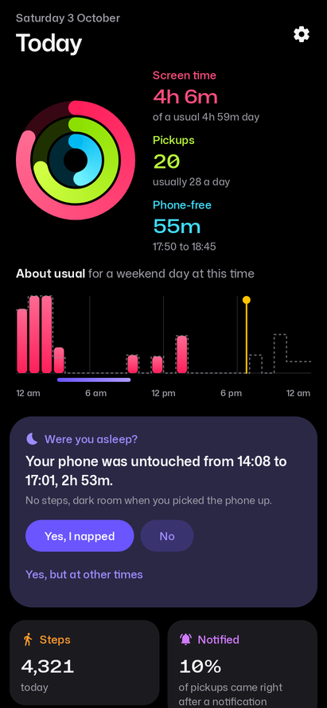<br>
      <b>True-black dark mode</b><br>
      <sub>One bright colour per measure, the same everywhere it appears: pink for screen time, lime for pickups, violet for sleep.</sub>
    </td>
    <td align="center" valign="top" width="33%">
      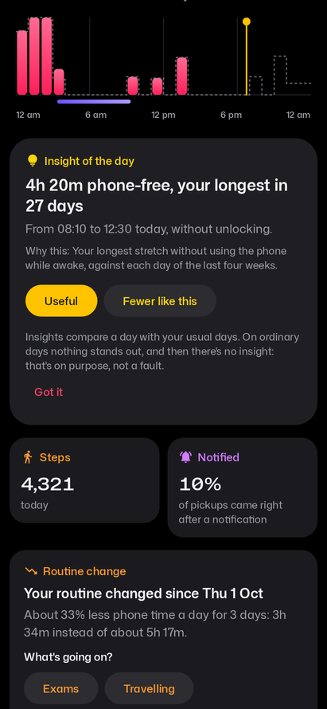<br>
      <b>Insight of the day</b><br>
      <sub>One thing that stood out, and why. Feedback is asked for only now and then, and steers what comes up.</sub>
    </td>
  </tr>
  <tr>
    <td align="center" valign="top" width="33%">
      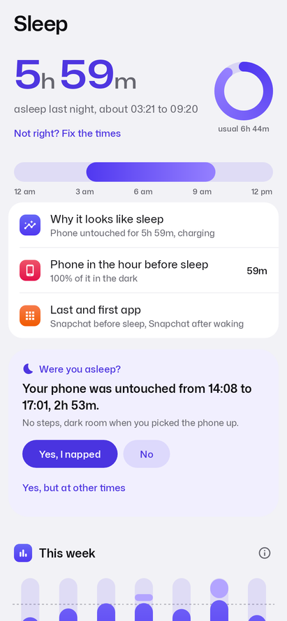<br>
      <b>Sleep</b><br>
      <sub>Last night with the reasons it looks like sleep, a fix-the-times sheet, and "Were you asleep?" after a nap.</sub>
    </td>
    <td align="center" valign="top" width="33%">
      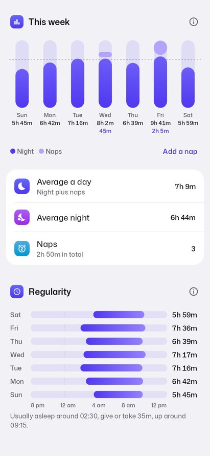<br>
      <b>This week</b><br>
      <sub>Each day's night with naps stacked on top and the nap time under the total. Tap a day for its details.</sub>
    </td>
    <td align="center" valign="top" width="33%">
      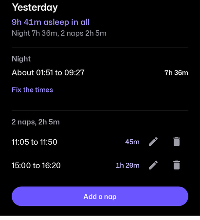<br>
      <b>A day's sleep</b><br>
      <sub>The night, each nap with its own times, and the total. Fix the night, or add, change and remove naps.</sub>
    </td>
  </tr>
  <tr>
    <td align="center" valign="top" width="33%">
      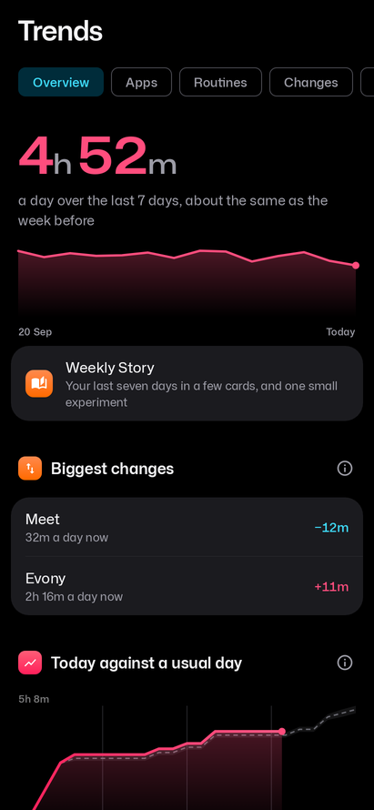<br>
      <b>Trends</b><br>
      <sub>The last 7 days against the week before, biggest changes, today against a usual day, and the week heatmap.</sub>
    </td>
    <td align="center" valign="top" width="33%">
      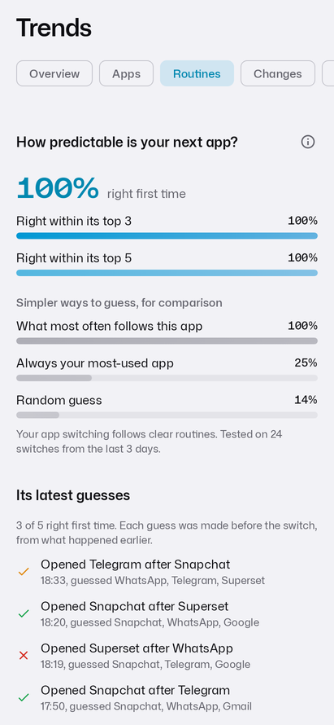<br>
      <b>Routines</b><br>
      <sub>How predictable your next app is, measured against simple baselines, its latest guesses, and your app sequences.</sub>
    </td>
    <td align="center" valign="top" width="33%">
      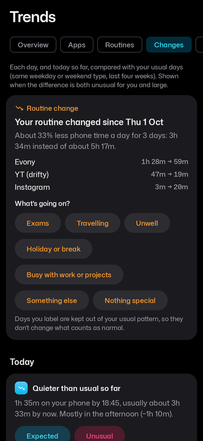<br>
      <b>Changes</b><br>
      <sub>Days that differ from your usual ones, in both directions, and routine changes such as an exam week.</sub>
    </td>
  </tr>
  <tr>
    <td align="center" valign="top" width="33%">
      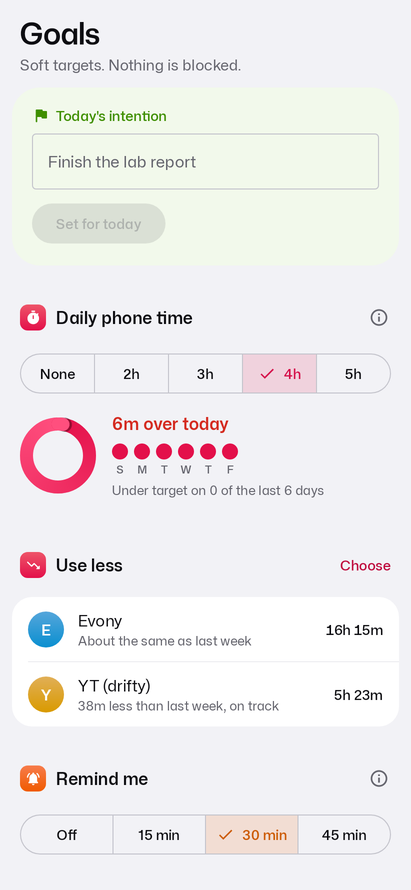<br>
      <b>Goals</b><br>
      <sub>Soft targets: a daily intention, a phone-time target, apps to use less or more, and reminders. Nothing is blocked.</sub>
    </td>
    <td align="center" valign="top" width="33%">
      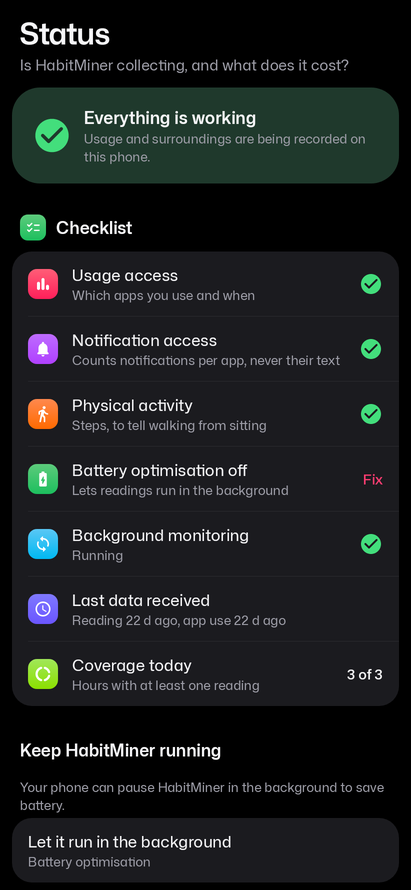<br>
      <b>Status</b><br>
      <sub>Whether collection is working, a permission checklist, and what HabitMiner itself costs in battery.</sub>
    </td>
    <td align="center" valign="top" width="33%">
      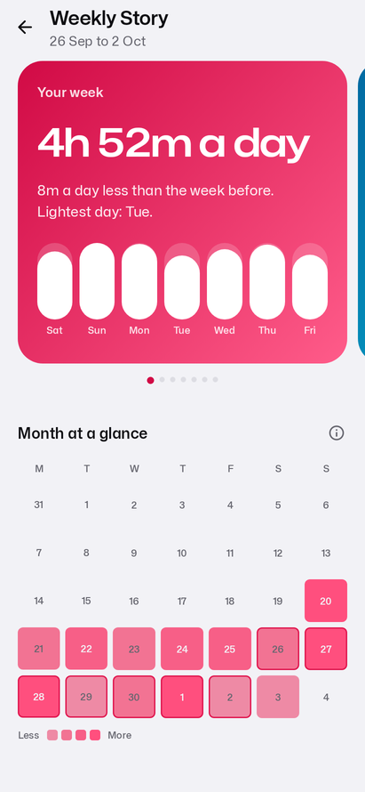<br>
      <b>Weekly Story</b><br>
      <sub>Your last seven days in a few cards, a month at a glance, and one small experiment to try.</sub>
    </td>
  </tr>
  <tr>
    <td align="center" valign="top" width="33%">
      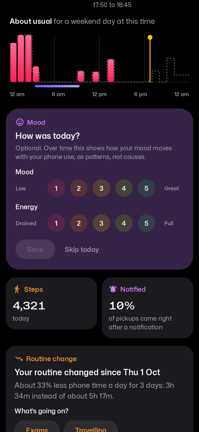<br>
      <b>Daily mood check</b><br>
      <sub>Mood and energy in two taps, at a time you choose, so mood can be read against phone use over time.</sub>
    </td>
    <td align="center" valign="top" width="33%">
      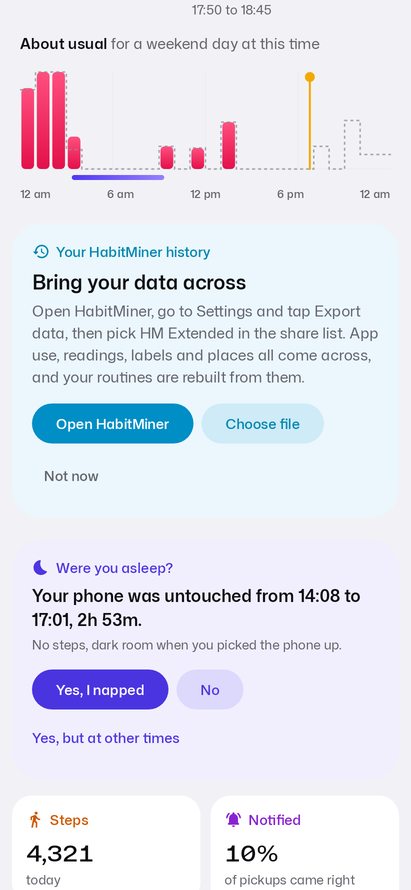<br>
      <b>Bring your data across</b><br>
      <sub>Import an export from the original HabitMiner: app use, readings, labels and places, with routines rebuilt.</sub>
    </td>
    <td align="center" valign="top" width="33%">
      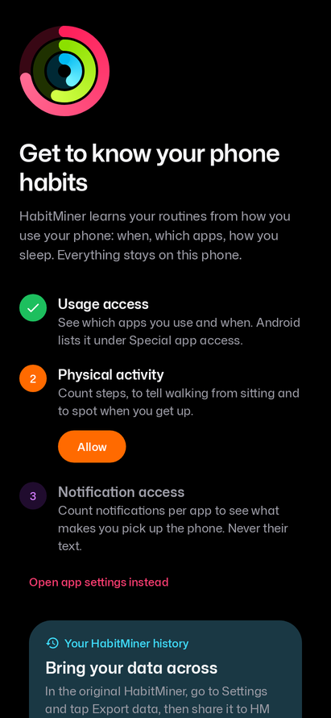<br>
      <b>First run</b><br>
      <sub>What each permission is for, in plain words, before Android asks.</sub>
    </td>
  </tr>
</table>

<sub>Rendered by the app's screenshot tests (Robolectric) with two weeks of sample data, so the numbers are illustrative. Every push to <code>habitminer-extended</code> regenerates them on the <code>ci-out-habitminer-extended</code> branch. Locally: <code>./gradlew testDebugUnitTest --tests "*ScreenshotTest*"</code>, images in <code>android/app/build/screenshots</code>.</sub>

---

## ✨ Features

**Tracking**
- **Screen time, pickups and phone-free time** from Android's usage log, with the alarm screen, launchers and system screens left out. Each day counts only the time used in it, also for sessions that run past midnight.
- **Sleep** from when the phone goes untouched at night, the step counter, darkness and charging. Quick checks, snoozed alarms and alarms you sleep through don't end the night; switching off your last alarm does. Optional Health Connect sleep and calendar busy times.
- **Naps**: daytime stretches with the phone untouched and no steps prompt "Were you asleep?". Add, change and remove naps yourself, several a day.
- **Surroundings**: light, motion (accelerometer, step counter and activity recognition), charging, headphones and, if you opt in, Wi-Fi places stored only as a salted hash.
- **Notifications**: how many pickups followed a notification, per app counts only, never the text.

**Understanding**
- **Usual days**: every day is compared with up to four weeks of days of the same kind (weekday or weekend), using medians so a few odd days don't skew "usual". Today is compared at the same time of day.
- **Changes** in both directions (total time, late nights, apps missing or spiking, unlocks, sleep) and routine changes over several days, which you can label (exams, travel, unwell, holiday) to keep them out of "usual".
- **Next-app model** that learns from what usually follows the current app, the hour, recent apps, notifications, headphones and charging, with its hit rate measured against simple baselines.
- **Insight of the day**, **Weekly Story**, and context insights such as screen time in the dark or after midnight.

**Acting on it**
- **Goals**: a daily intention, a phone-time target, apps to use less or more, and reminders when you're over.
- **Gentle nudges**, an optional **mindful pause** and **focus sessions** (both off by default), a home-screen **widget**, a **Quick Settings tile** and app **shortcuts**.
- **Quick check-ins** and **Expected / Unusual** answers are saved as ground-truth labels, with the context at the time.

**Your data**
- **Export** everything as a ZIP of CSV files with a README and schema, or a **privacy-safe** export with app names and keys replaced. **Import** exports from either app.
- **Status** shows whether collection is working and HabitMiner's own CPU, wake-lock and sensor use as a share of battery.
- **Updates**: checks for a new GitHub release once a day, verifies the download and installs it when you agree.

---

## 🆕 What's new in Extended

### 2.0: redesign and new features
- **Vivid redesign**: activity rings on Today, one bright colour per measure, true-black dark mode, coloured icon tiles and gradient charts, five tabs (Today, Trends, Sleep, Goals, Status) each with its own colour, and the Mona Sans typeface.
- **Separate app** (`com.habitminer.extended`, "HM Extended") that can run next to the original, plus an import card on Today to bring your HabitMiner history across.
- **Sleep accuracy**: fix-a-night (and HabitMiner learns how long you usually take to fall asleep), sleep evidence, Do Not Disturb, alarm and glance signals, optional Health Connect sleep and calendar busy times.
- **Engagement**: insight of the day, questions sent at moments you're likely to answer, reminders, Weekly Story, mood check-ins.
- **Control**: widget, Quick Settings tile, shortcuts, pause and breaks, choosing data sources, and a guide for Android's restricted settings.
- **Battery**: readings driven by alarms instead of a long wake lock, an incremental usage log, one shared analysis for every screen, and a battery-cost stat on Status.
- **Export and updates**: insight log and self-health in exports, a privacy-safe option, daily release check with verified install, and a release workflow.

### Fixes from daily use (B1–B7)
Seven bugs reported while using the app day to day, all fixed and checked against two full exports. Details, and before/after numbers, are in [docs/BUGS.md](docs/BUGS.md).

| | Problem | What changed |
|---|---|---|
| B1 | A quiet alarm nobody heard counted as waking up, and as screen time | An alarm screen over the lock screen is no longer app use. A quickly snoozed alarm is a brief wake-up; one that rang out unheard isn't. |
| B2 | Day totals missed use that ran past midnight | Sessions are split at midnight, so every total agrees with the heatmap. Stored data is repaired once. |
| B3 | "On the move 307 times" | Needs the step counter or activity recognition, not a phone moved in your hand, and counts trips. |
| B4 | A nap wasn't found, no nap notification, no way to add naps | Better nap detection, "Were you asleep?" sent for any nap of an hour or more, and naps added by hand (several a day). |
| B5 | Week view lost per-day night and nap details | "This week" shows nap time per day; tap a day for the night, each nap and its times. |
| B6 | Wake-up shown in the future | The learned adjustment can't pass now or your first real use; switching off your last alarm ends the night. |
| B7 | Insight card kept asking for feedback; mood check rare | Thanks with Undo, then hidden for the day; feedback asked only now and then; mood check at a time you choose. |

On the nights with corrected times, wake-up errors went from up to 163 minutes off to at most 20.

---

## 🏗️ Architecture

- **UI**: Jetpack Compose and Material 3 (Compose BOM 2025.12, Material 3 1.4), adaptive navigation, Glance widget.
- **State**: unidirectional data flow with `StateFlow` and a Hilt `ViewModel`.
- **Data**: Room 2.8 with an exported schema, repositories, and SharedPreferences for settings.
- **Background**: a foreground service for collection with WorkManager as a fallback, and alarm-driven sensor readings.
- **Analytics**: plain Kotlin in `analytics/` (sleep and nap detection, usual days, changes, next-app model, insights), with no Android dependencies so it's unit-tested directly.
- **Build**: Kotlin 2.3, AGP 8.11, Hilt 2.57, KSP, minSdk 26, targetSdk 35, compileSdk 36, R8 for release builds.

```text
android/app/src/main/java/com/habitminer/
├── collection/   usage log reader, sensors, device events (unlocks, alarms, Do Not Disturb)
├── data/         Room entities and DAOs, import/export
├── repository/   access to stored data for the rest of the app
├── analytics/    pure Kotlin: sleep, naps, usual days, changes, routines, insights
├── engine/       analysis pipeline and the ViewModel
├── goals/        targets, intentions and reminders
├── mindful/      mindful pause and focus sessions
├── proactive/    questions, nudges, reminders, notifications
├── update/       release check and install
├── widget/       home-screen widget
└── ui/           Compose screens and the design system
```

More background on the original design is in [docs/ARCHITECTURE.md](docs/ARCHITECTURE.md) and [docs/METHODOLOGY.md](docs/METHODOLOGY.md).

---

## 🚀 Getting started

### Install
Every push to `habitminer-extended` builds the APK in CI and publishes it on the `ci-out-habitminer-extended` branch as `HabitMinerExtended.apk`. It installs next to the original HabitMiner and keeps its data across updates.

To bring your history across: in HabitMiner, open Settings and tap **Export data**, then share the ZIP to **HM Extended** (or use **Choose file** on the Today import card).

### Build
```bash
cd android

./gradlew testDebugUnitTest      # unit and screenshot tests
./gradlew assembleDebug          # debug APK
./gradlew assembleRelease        # release APK (R8)
adb install -r app/build/outputs/apk/debug/app-debug.apk
```

Requires JDK 21 and a physical Android 8.0+ device; emulators don't produce realistic usage or sensor data.

### Permissions
- **Usage access**: which apps you use and when.
- **Notification access**: notification counts per app, never their text.
- **Physical activity**: steps and activity recognition, to tell walking from sitting.
- **Battery optimisation off**: so Android doesn't stop collection in the background.
- **Optional**: Health Connect (sleep), calendar (busy times), location (only to see the Wi-Fi network for places; no location is recorded).

---

## 📄 License
Distributed under the MIT License. The README for HabitMiner 1.3.1 is kept as [README_OLD.md](README_OLD.md).
